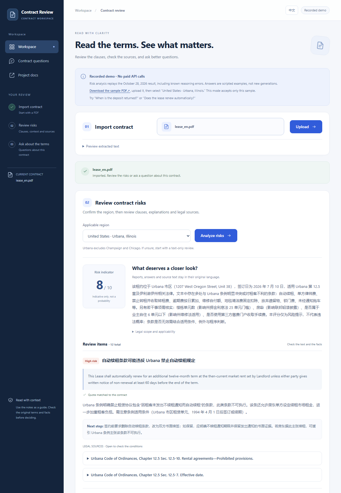
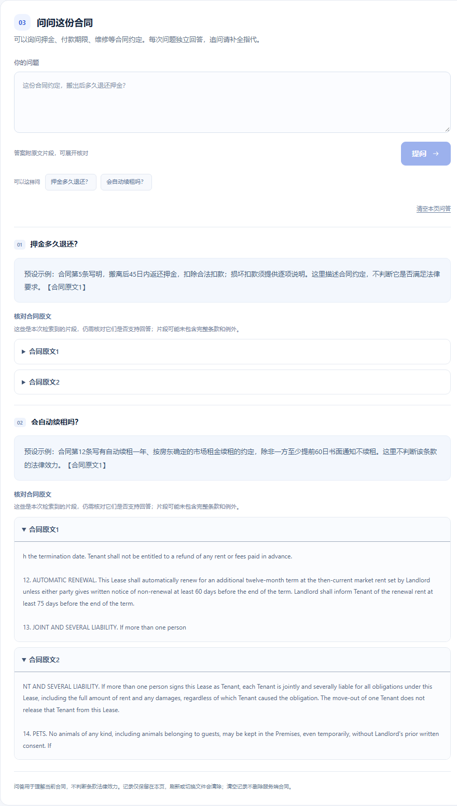

# Contract Risk Analyzer / 合同防踩坑工具

[](https://github.com/GlennShi7/contract-analyzer/actions/workflows/ci.yml)

A full-stack prototype that extracts text from PDF contracts, generates structured risk cards with DeepSeek, and supports semantic clause Q&A in the browser and through a FastAPI endpoint.

Built to help people understand unfavorable terms in rental and employment contracts before signing, and find relevant contract clauses when questions arise afterward.

## Try the replay without an API key

```bash
cd frontend
npm ci
npm run demo
```

Open `http://127.0.0.1:5174`, download and upload the supplied synthetic PDF, choose Urbana, and explore the recorded risk report. Two preset questions demonstrate answers with source excerpts. This mode makes no model calls: analysis replays a saved run with known reasoning errors, and Q&A is scripted. See [the walkthrough, scope and reproduction instructions](demo/README.md). Use the normal app below for actual PDF parsing, retrieval and new generation.

Captured from the actual replay UI; the banner identifies the historical output and its limitations:



Scripted Q&A with exact original-text chunks:



## Implemented

- React frontend: upload a PDF, select the applicable region, view risk cards and official legal sources, and ask questions with expandable contract excerpts.
- FastAPI backend: PDF extraction with pdfplumber and whole-document analysis through the DeepSeek API.
- Hand-written RAG: overlapping character chunks, multilingual MiniLM embeddings, persistent ChromaDB, and document-filtered top-3 retrieval.
- Stable SHA-256 document IDs, server-side text persistence, repeat-upload replacement, and source excerpts in Q&A responses.
- Retrieval evaluation: 56 labeled questions across three synthetic contracts, including Chinese questions about an English lease.
- API credentials loaded from a local `.env` file.
- Curated Chinese mainland labor and tenancy statutes: 24 selected articles per group, copied from official sources with version and provenance metadata.
- Urbana, Illinois residential lease profile: 21 municipal, 15 state, and 7 federal provisions with applicability notes and official-source metadata.
- JSON mode, Pydantic validation, one correction retry, contract-quote matching, and filtering of unknown legal reference IDs.

Legal profiles require an explicit region choice and a recognized contract type. English and Chinese keywords classify the contract type; language does not select governing law.

## Architecture

```text
PDF -> /upload -> SHA-256 document ID + pdfplumber text extraction
              -> full text saved in backend/data/{doc_id}.txt
              -> 500-character chunks, 50-character overlap
              -> multilingual embeddings + doc_id metadata -> ChromaDB
              -> doc_id, filename, preview, n_chunks -> frontend

doc_id + region   -> /analyze -> full text + selected statutes -> DeepSeek JSON
                             -> schema validation -> quote and reference checks
                             -> risk cards + official legal sources
doc_id + question -> /ask -> retrieve up to 3 chunks from this document
                         -> excerpts + question -> DeepSeek -> answer + sources
```

The frontend retains the document ID instead of receiving and resubmitting the full text. `/analyze` loads the stored text; `/ask` filters on the document ID. The embedding model runs locally; generation uses the DeepSeek API.

Document IDs use the complete SHA-256 hash of the uploaded PDF bytes. Renaming the same file preserves its ID; different contents with the same filename receive different IDs. Re-uploading replaces its indexed chunks and removes stale chunks. Local data is excluded from Git. PDFs uploaded before this change need to be uploaded again to create the stored text and document metadata.

## Run locally

For a container-based demo, see [Docker Compose setup](DEPLOYMENT.md). It serves the app at `http://localhost:8080` with a same-origin API proxy and persistent named volumes. The [CI workflow](.github/workflows/ci.yml) checks backend tests, frontend build/lint/browser behavior, and container startup without paid model calls.

Container checks also exercise actual PDF parsing and CPU embeddings with two identical-text synthetic documents, followed by offline retrieval after recreating the containers without another upload. See [the real-embedding smoke commands](DEPLOYMENT.md#checks-without-paid-calls). This fixed-question persistence check is separate from the retrieval benchmark and does not measure answer quality.

The existing backend environment uses Python 3.14.5. The existing frontend environment uses Node.js 26.5.1 and npm 11.17.0. These record the development environment, rather than a compatibility guarantee for every platform.

Commands below use Windows Git Bash. The first embedding request may download model weights.

```bash
git clone https://github.com/GlennShi7/contract-analyzer.git
cd contract-analyzer/backend
python -m venv venv
source venv/Scripts/activate
python -m pip install -r requirements.txt
cp .env.example .env
```

Set `DEEPSEEK_API_KEY` in `backend/.env`, then start the backend:

`DEEPSEEK_MODEL` defaults to `deepseek-flash`, as documented by the [current DeepSeek API guide](https://api-docs.deepseek.com/). It can be overridden in `.env`. Generation uses non-thinking mode; structured analysis permits at most two requests, and SDK automatic retries are disabled.

```bash
uvicorn main:app --reload
```

Open [API documentation](http://127.0.0.1:8000/docs). In a second Git Bash terminal, from the repository root:

```bash
cd frontend
npm ci
npm run dev
```

Open [the frontend](http://localhost:5173). Upload a text-based PDF, confirm the applicable region, then click analyze. The region defaults to other/unknown; choose Chinese mainland or Urbana, Illinois to enable a supported legal profile. The frontend defaults to `http://127.0.0.1:8000`; set `VITE_API_URL` to override it. The backend currently allows the frontend CORS origin `http://localhost:5173`.

## Contract Q&A

After uploading, use **问问这份合同** to ask about deposit returns, payment deadlines, repairs or other contract terms. The browser sends the current document ID and question to `/ask`, then displays the latest answer and expandable numbered contract excerpts. Q&A is independent of the legal-region selector; it interprets retrieved contract text without injecting statutes or establishing legal validity. Each question stands alone, without prior conversation history.

Switching files clears the question and answer and aborts the pending browser fetch. Cancellation does not guarantee that server-side generation or billing has stopped. Blank submissions and concurrent duplicate submissions are blocked. Responses with empty answers or mismatched document/source IDs are rejected. Empty or truncated model responses return 502 rather than a successful blank answer. Retrieved excerpts still need human review: finding a passage does not prove that it supports the answer, and other relevant terms may be missing.

Validation: 81 backend tests passed; frontend build and lint passed; isolated headless Edge checks exercised the actual React interface with a local mock API, including errors, source isolation, literal-text rendering, file changes during pending requests, and mobile width. No paid API request was made for this feature. Reproduce browser checks with `npm run check:qa-ui` in `frontend`; see [frontend instructions](frontend/README.md).

## API

| Endpoint | Request | Response |
| --- | --- | --- |
| `GET /hello` | None | Startup message |
| `POST /upload` | Multipart field `file` containing a PDF | `doc_id`, `filename`, `preview`, `n_chunks` |
| `POST /analyze` | `{"doc_id": "<64-character lowercase SHA-256>", "jurisdiction": "cn"}` | `doc_id`, structured `result` |
| `POST /ask` | `{"doc_id": "<SHA-256>", "question": "When is the deposit returned?"}` | `doc_id`, `answer`, `sources` |

The Q&A endpoint is connected to the React interface and can also be tried through `/docs`. It makes one generation request per question, with SDK retries disabled.

Each source has `doc_id`, a zero-based `chunk` index, and the retrieved `text`. Invalid or textless PDFs return 400; unknown document IDs return 404; a missing index returns 409; malformed request fields return 422; DeepSeek request failures return 502. An unconfigured API key returns 503 when generation is requested.

`/analyze` accepts `jurisdiction` as `cn`, `us_il_urbana`, or `unknown` (the default). Its result includes `contract_type`, `risk_score` (1-10), `summary`, `cards`, `legal_sources`, `legal_scope`, `grounding`, `model`, and `attempts`. Each card contains a title, contract quote, risk level, explanation, legal reference IDs, suggestion, and server-computed quote-matching fields. Invalid model output is retried once; another failure returns 502.

## Structured analysis and citation checks

The [curated law library](backend/laws/README.md) records official URLs, versions, checked dates, and checksums. Only the selected contract type's articles are injected. The Urbana profile applies only to residential leases within Urbana city limits, not neighboring Champaign or Chicago. Recognized location conflicts suppress legal injection; the keyword check is not address verification. Unknown regions and unsupported contract types receive text-based hints without statutory citations.

The analyzer requests [JSON output](https://api-docs.deepseek.com/guides/json_mode/) and validates its fields with Pydantic. Exact quotes and conservative whitespace matches are marked `verified`. Approximate matches remain unverified: changing a negation or number can preserve high text similarity while changing meaning. English word boundaries are preserved. Unknown law IDs are removed, and only the referenced official articles are returned to the frontend.

`grounding` reports quote-verification and legal-ID membership counts before unknown references are filtered. Rates are `null` when there are no cards or references. These are structural checks, not measures of legal correctness, applicability, or risk recall. Scores are model-generated hints and are not calibrated legal-risk probabilities.

Offline tests cover parsing, invalid fields, correction limits, reference filtering, region routing, endpoint errors, and quote changes. The actual React interface was checked in headless Edge using a local mock API.

The [2026-10-27 live run](backend/eval/results/analysis_20261027-152735.json) used `deepseek-flash` on the three existing synthetic contracts, with one request each and no correction retries:

| Contract | Risk cards | Quotes matched exactly | References to injected law IDs |
| --- | --- | --- | --- |
| Chinese lease | 10 | 10/10 | 22/22 |
| Chinese employment contract | 11 | 11/11 | 21/21 |
| English Illinois lease | 8 | 8/8 | No statutory references |
| Total | 29 | 29/29 | 43/43 |

These are quote-matching and ID-membership checks, not legal-accuracy results. Qualitative inspection found unsupported legal generalizations in the English sample despite the absence of injected laws. The model can also overstate what a correctly identified statute supports. See [the run review and limitations](backend/eval/ANALYSIS_REVIEW_2026-10-27.md).

The table above records the earlier unknown-region baseline, before the Urbana profile was added.

The [2026-10-28 Urbana-profile run](backend/eval/results/analysis_20261028-161231.json) analyzed only the existing synthetic English lease: one request, no retry, 12/12 exact contract quotes and 18/18 references to supplied IDs. It used 26,207 total tokens. [Source spot-checks and limitations](backend/eval/URBANA_ANALYSIS_REVIEW_2026-10-28.md) document remaining errors, including treating consent-based subletting as a prohibition, overstating proof requirements for maintenance agreements, and assuming city boundaries from an address. These counts do not establish legal accuracy or completeness.

The [interpretation follow-up](backend/eval/URBANA_REASONING_FOLLOWUP_2026-10-28.md) adds more precise applicability guidance and an explicit unverified-boundary notice. Its one-request live rerun produced no validated report; the request cap blocked a correction attempt. No reasoning improvement is claimed. The evaluator now preserves rejected-response diagnostics with no success metrics. Local tests: 76 passed.

An optional script is available for explicitly authorized, billable verification on the three synthetic contracts:

```bash
cd backend
source venv/Scripts/activate
python -m eval.analysis_eval --help
# Only when you intend to make billable API requests:
python -m eval.analysis_eval --live --contracts lease_en --english-jurisdiction us_il_urbana --max-requests 2
```

It sends only selected fixtures from the three existing synthetic evaluation contracts, permits at most two requests per contract and enforces an explicit total request limit, and saves model, usage, citation counts, and structured responses. It does not measure legal correctness.

## Retrieval evaluation

The [2026-10-27 run](backend/eval/results/retrieval_20261027-150842.json) compares document-filtered production retrieval against an unfiltered reproduction of the original bug. Both experiments use the same 56 questions and 500-character chunks with 50-character overlap:

| Experiment | Hit@3 | Random baseline@3 | Retrieved chunks from other contracts |
| --- | --- | --- | --- |
| Shared collection, with document filter | 73.2% (41/56 questions) | 30.9% within the selected document | 0.0% |
| Shared collection, without filtering (old bug) | 58.9% (33/56 questions) | Not reported for the mixed pool | 43.5% |

A hit means at least one retrieved chunk covers half of a labeled answer span. This measures retrieval, not final answer correctness or risk-detection accuracy. The filtered experiment calls the production `store_chunks` and `search_chunks` functions with an in-memory collection. `/ask` now also retrieves top-3. No DeepSeek API call is part of this evaluation.

The [original 2026-10-19 run](backend/eval/results/retrieval_20261019-125133.json) is retained for comparison. See [evaluation methodology and commands](backend/eval/README.md).

```bash
cd backend
source venv/Scripts/activate
python -m pip install -r requirements-dev.txt
python -m pytest tests eval -q
python -m eval.retrieval_eval
# Optional: python -m eval.retrieval_eval --sweep
```

## Limitations

- Document filtering is not user authentication or access control. The prototype has no accounts; use synthetic documents for development.
- Scanned PDFs require OCR, which is not implemented.
- The statute library is selective and omits many laws, local rules, judicial interpretations, and technical standards. The Urbana municipal text comes from a user-supplied official export labeled 20260417; later amendments must be checked. Its Chapter 5 technical codes are not reproduced in that export. Matching a quote or allowing a law ID does not establish that the law supports the model's explanation.
- Live analysis has been checked on only three synthetic contracts. Quote and ID checks do not measure legal correctness or risk recall; unsupported legal generalizations were observed in the English sample.
- The evaluation set is small and synthetic. Retrieval metrics exclude PDF extraction and LLM generation; the separate live analysis check measures only structural citation properties. Scores are not calibrated.

This is a development prototype, not legal advice.

## License

[MIT](LICENSE)
