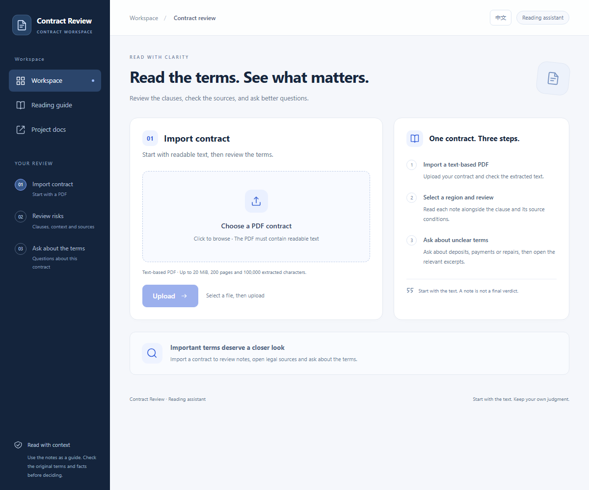

# Contract Risk Analyzer / 合同防踩坑工具

[English](README.md) | **简体中文**

[](https://github.com/GlennShi7/contract-analyzer/actions/workflows/ci.yml)

一个帮助阅读租赁、劳动合同的全栈原型：上传含文字的 PDF，查看带合同原文和法条来源的风险卡片，或围绕当前合同提问。

**工程主流程已实现，模型法律解释质量尚未通过验收。** 逐字引用匹配、法条 ID 校验和自动化测试通过，都不代表法律结论正确。详细实现、实验过程与遗留问题见[中文收尾报告](docs/FINAL_REPORT.zh-CN.md)、[当前状态](PROGRESS.md)和[最近一次真实评测](backend/eval/COMPLETION_REVIEW_2026-10-30.md)。



[手机界面](docs/images/workspace-mobile.png)。界面默认英文，右上角可切换中文并保存偏好。切换只影响按钮、导航、提示和已知固定消息；模型报告、回答、合同和法条原文保留原有语言。

## 不用 API key，先看演示

```bash
cd frontend
npm ci
npm run demo
```

打开 `http://127.0.0.1:5174`，从页面下载合成 PDF，上传后选择 **United States · Urbana, Illinois**，再点击分析。可试问：

- `When is the deposit returned?`
- `Does the lease renew automatically?`

这两个问题也支持页面中文按钮及原中文问法。**这是明确标注的回放演示**：只接受仓库内指定合成 PDF，风险报告回放2026年10月28日的历史结果，问答返回两条预设答案；没有新解析、实时检索或付费生成。历史结果含已知解释错误，不用新结果替换来美化演示。详见[演示说明](demo/README.md)。

<details>
<summary>展开查看风险报告与问答截图</summary>


</details>

## 已实现的功能

| 模块 | 行为 |
| --- | --- |
| PDF 导入 | pdfplumber 提取文字；最多20 MiB、200页、100,000个提取字符；拒绝加密、无文字或损坏文件 |
| 文档标识 | 对上传 PDF 原始字节计算完整 SHA-256；改文件名不改 ID，不同内容同名文件也不会合并 |
| 全文保存 | 提取文字保存为服务端 `backend/data/{doc_id}.txt`，分析时按 ID 读取 |
| 合同问答 | 手写 RAG；多语言嵌入、本地持久化 ChromaDB、限定当前文档的 top-3 检索 |
| 风险报告 | 全文与所选法条送入 DeepSeek；JSON/Pydantic 校验，最多一次纠错，严格合同引文校验 |
| 法条来源 | 中国大陆劳动与租赁各24条；Urbana住宅租赁43条，附来源、版本、校验和与适用说明 |
| 阅读界面 | 响应式布局，提取文字预览、风险分级、可展开法条、逐次问答历史、英文/中文界面 |
| 错误恢复 | 重复提交保护、换文件清空旧结果并中止分析/问答浏览器请求、拒绝错文档及畸形响应 |
| 工程验证 | 后端测试、实际浏览器检查、Docker Compose、真实CPU嵌入及容器重建后离线检索 |

没有使用 LangChain，也没有训练新的嵌入模型。嵌入在本地运行，文本生成调用外部 DeepSeek API。

## 两条分析链路

```text
PDF → /upload → SHA-256 ID + 提取全文 → 服务端文字文件
                                    → 500字符切块 / 50字符重叠
                                    → 多语言嵌入 → 带doc_id的Chroma索引

doc_id + 地区 → /analyze → 全文 + 对应法条 → DeepSeek结构化生成
                         → 字段、合同引文、法条ID校验 → 风险报告

doc_id + 问题 → /ask → 只检索当前合同的最多3块 → DeepSeek
                     → 回答 + 编号合同片段
```

全文风险分析不先走 top-3 检索；问答不会自动获得整份合同或法条库。地区选择影响 `/analyze`，不改变 `/ask` 的检索问答逻辑。

合同类型由中英文关键词保守分类；适用地区由用户明确选择，**不是根据合同语言推断**。默认地区为 `unknown`，不注入法律。`cn` 支持所选中国大陆劳动/租赁资料；`us_il_urbana` 只支持 Urbana 市界内住宅租赁，不涵盖 Champaign、Chicago 或美国劳动合同。关键词冲突检查不是市界、地址或适用法核验。

## 启动真实应用

### 方式一：Docker Compose

需要可用的 Linux 容器引擎。在仓库根目录：

```bash
# 首次配置才复制；已有.env时保留原文件。
cp backend/.env.example backend/.env
# 编辑backend/.env，填入自己的DEEPSEEK_API_KEY。
docker compose up --build -d --wait
```

打开 `http://localhost:8080`，接口文档为 `http://localhost:8080/api/docs`。服务仅绑定本机 `127.0.0.1`；这不等于公开部署。前端通过 `/api` 同源代理访问后端。

首次有效上传可能下载嵌入模型；健康检查不会下载模型或调用 DeepSeek。没有 API key 也能启动和进行部分非生成操作，但风险分析和真实问答会返回503。

```bash
docker compose ps
docker compose logs --tail 100
docker compose down
```

普通 `down` 保留文字、向量和模型缓存卷。只有明确要删这些数据时才使用 `--volumes`。更新 key 后需重建后端容器。更多细节见[部署说明](DEPLOYMENT.md)。

### 方式二：本机开发

以下为 Windows PowerShell。CI 使用 Python 3.13 和 Node 24；已记录的本机开发环境为 Python 3.14.5、Node 26.5.1、npm 11.17.0，不表示任意版本组合均已验证。

```powershell
git clone https://github.com/GlennShi7/contract-analyzer.git
cd contract-analyzer\backend
python -m venv venv
.\venv\Scripts\python.exe -m pip install -r requirements.txt
# 仅首次配置；如果已有.env，不要覆盖。
Copy-Item .env.example .env
# 编辑.env，填入DEEPSEEK_API_KEY。
.\venv\Scripts\python.exe -m uvicorn main:app --reload
```

另一终端在仓库根目录运行：

```powershell
cd frontend
npm ci
npm run dev
```

访问 `http://localhost:5173`，原生接口文档为 `http://127.0.0.1:8000/docs`。当前 CORS 允许 `http://localhost:5173`；随意改成其他主机名或端口可能无法访问接口。`VITE_API_URL` 可覆盖默认后端地址，修改后重启 Vite。

| 配置 | 当前行为 |
| --- | --- |
| `DEEPSEEK_API_KEY` | 仅服务端读取；不放进前端或提交Git |
| `DEEPSEEK_MODEL` | 默认 `deepseek-flash`；可以覆盖；这是代码默认值，不是对提供方长期支持的承诺 |
| `VITE_API_URL` | 开发默认 `http://127.0.0.1:8000`；容器构建为 `/api` |
| 生成预算 | 单份分析最多2次请求（含纠错）；每个问答1次；SDK自动重试关闭 |

普通真实分析和问答会计费。浏览器中止请求不保证服务端生成或费用也被取消。

## API 与错误码

| 接口 | 输入 | 返回 |
| --- | --- | --- |
| `GET /hello` | 无 | 进程启动消息 |
| `POST /upload` | multipart文件字段 `file` | `doc_id`、`filename`、前200字符 `preview`、`n_chunks` |
| `POST /analyze` | `doc_id`、`jurisdiction`（`unknown`/`cn`/`us_il_urbana`） | `doc_id`、结构化 `result` |
| `POST /ask` | `doc_id`、1至4000字符的 `question` | `doc_id`、`answer`、`sources` |

`doc_id` 是64位小写十六进制 SHA-256。问答来源含 `doc_id`、从0开始的 `chunk` 序号及 `text`。风险报告含类型、1—10分提示评分、摘要、卡片、所引法条、范围说明、校验统计、模型及尝试次数。

| HTTP 状态 | 典型原因 |
| --- | --- |
| 400 | PDF损坏、加密、无法提取文字 |
| 404 | 合同文字不存在，需要重新上传 |
| 409 | 合同索引缺失，需要重新上传 |
| 413 | 文件、页数或提取文字超限 |
| 422 | 请求字段、ID、地区或问题格式错误 |
| 502 | 模型服务失败、输出截断/为空、分析纠错后仍未通过校验 |
| 503 | 未配置key，或嵌入模型、索引、存储不可用 |

问答历史只保存在当前页面。每次请求只发当前问题和文档ID；先前问答不会作为对话上下文发送。清空历史不会删除服务端合同，刷新或换文件会清空页面历史。

## 检索评测结果

在同一组56个标注问题、3份合成合同、500/50切块与top-3设置下：

| 实验 | Hit@3 | 随机基线@3 | 返回片段来自其他合同的比例 |
| --- | --- | --- | --- |
| 共享库，按文档过滤 | 73.2%（41/56） | 30.9% | 0.0% |
| 共享库，不按文档过滤的旧问题复现 | 58.9%（33/56） | 混合池未单列 | 43.5% |

命中表示至少一个检索块覆盖标注答案句的一半，不是最终回答正确率。43.5%和0%以返回片段为分母，不能与41/56的问题分母混用。此评测不调用 DeepSeek，不覆盖 PDF 提取或生成过程。[原始结果](backend/eval/results/retrieval_20261027-150842.json)与[评测方法](backend/eval/README.md)可复查。

## 最近一次真实生成与质量结论

2026年10月30日，在明确授权的独立批次中，对16个短案例与3份完整合成合同各测两遍：38项生成任务，共41次请求（上限76，含纠错）。37份通过结构及引文校验，1项因为两次把违约金收款方从甲方改成乙方而被拒绝。有效报告共215处逐字匹配引文、400条集合内法条ID引用。

选择性工程评审仍记录13条失败发现，包括把已写明的正常磨损限制或起算日期说成缺失、遗漏例外、标题改变批准条件、用无关引文支持缺失信息卡片等。18个两轮都有效的输入中，2个分数变化、14个卡片数变化。**不能把37/38、215/215或400/400当成法律准确率。** 本批已结束，未用额度不挪作新版本复测。

[完整评审](backend/eval/COMPLETION_REVIEW_2026-10-30.md)、[原始请求及结果](backend/eval/results/completion_20261030/ledger.json)、[对照表](backend/eval/results/completion_20261030/comparison.json)、[证据锚点](backend/eval/results/completion_20261030/selected-review.json)。此前10月27—29日的不同代码/资料快照保留在[评测目录](backend/eval/README.md)，不能混成同一版本的指标。

## 验证与复现

从 `backend` 运行，不新增付费请求：

```powershell
.\venv\Scripts\python.exe -m pip install -r requirements-dev.txt
.\venv\Scripts\python.exe -m pytest tests eval -q
.\venv\Scripts\python.exe -m eval.reasoning_review
.\venv\Scripts\python.exe -m eval.acceptance_review eval/results/completion_20261030/ledger.json --review eval/results/completion_20261030/selected-review.json
```

最后一条需要与保存结果相匹配的代码、资料及模型配置快照；以后修改实现，不能把旧响应冒充为新版本的实测结果。

从 `frontend` 运行：

```bash
npm run lint
npm run build
npm run test:demo
npm run check:qa-ui
npm run check:demo-ui
```

浏览器检查默认使用 Windows Edge；其他 Chromium 可通过 `EDGE_PATH` 指定，具体端口、输出目录和依赖见[前端说明](frontend/README.md)。这些检查使用本地模拟接口或回放，不调用付费模型。

截至文档核对时，代码基线 `7f59855` 的[CI](https://github.com/GlennShi7/contract-analyzer/actions/runs/41137876891)已通过154项后端测试、前端检查和真实容器检查，后者含三次严格离线重开。当前提交状态看顶部徽章。真实检索评测可在 `backend` 运行 `python -m eval.retrieval_eval`，会使用本地嵌入模型、可能下载权重，不调用 DeepSeek；`--sweep` 可扫描切块参数。容器独占检查命令与限制见[部署文档](DEPLOYMENT.md#exclusive-storage-inspection)。

## 边界与资料维护

- 没有账号、鉴权或每用户权限隔离；`doc_id`过滤不是安全访问控制。当前不是公开多用户服务，没有已验证用户人数。
- 不支持扫描件OCR，没有任务队列、自动全文语义审校或完整的法律风险召回保证。
- 原始PDF临时副本会清理；提取文字、索引和模型缓存会保留。索引与全文写入不是跨存储事务，失败后可重新上传修复。
- 法条是选择性历史快照，不是实时法律数据库。Urbana资料来自标识为20260417的官方导出；其他章节有截断/缺失技术规范，未补造或注入。
- [中国大陆资料说明](backend/laws/README.md)与[Urbana资料说明](backend/laws/URBANA.md)记录来源和范围。校验和只能发现变动，不能证明法律仍然有效或适用。
- 风险分数未经校准；问答片段也不保证包含全部例外。模型解释和建议须结合原文与实际事实复核。

本项目供合同阅读与工程实验使用，不构成法律意见。代码采用 [MIT License](LICENSE)。
