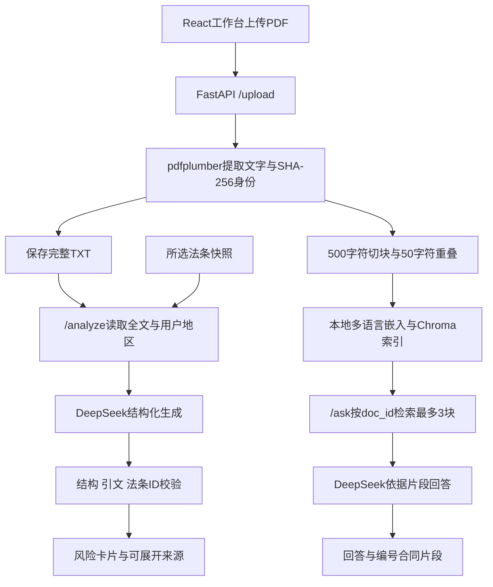

# Contract Analyzer 项目收尾报告

核对日期：2026年10月30日。本文依据当前仓库、保存的评测数据和已完成的工程检查编写。最近一次完整通过的工程基线为 `7f59855`，[CI记录](https://github.com/GlennShi7/contract-analyzer/actions/runs/41137876891)包含154项后端测试、前端实际浏览器检查和真实容器检查。本报告所在提交主要整理文档；新提交状态以仓库CI为准。

**结论：原型工程与本轮评测、证据整理已经完成，模型法律解释质量没有通过验收。** 这里的“收尾”指清点已经实现的功能、说明实现与取舍、保存成功和失败证据，并明确后续边界，不表示所有模型问题已经解决。

## 阅读导航

1. [目标、范围与交付状态](#1-目标范围与交付状态)
2. [总体架构与技术选择](#2-总体架构与技术选择)
3. [PDF导入、身份与存储](#3-pdf导入身份与存储)
4. [切块、嵌入与检索隔离](#4-切块嵌入与检索隔离)
5. [风险生成、结构与原文校验](#5-风险生成结构与原文校验)
6. [法条资料、地区路由与维护](#6-法条资料地区路由与维护)
7. [合同问答](#7-合同问答)
8. [前端设计、状态与语言](#8-前端设计状态与语言)
9. [接口、参数与异常恢复](#9-接口参数与异常恢复)
10. [部署、依赖与数据边界](#10-部署依赖与数据边界)
11. [测试与真实容器验证](#11-测试与真实容器验证)
12. [检索实验](#12-检索实验)
13. [真实生成实验与失败分析](#13-真实生成实验与失败分析)
14. [可复现证据与预算机制](#14-可复现证据与预算机制)
15. [迭代过程、已解决问题与剩余工作](#15-迭代过程已解决问题与剩余工作)
16. [运行、排查与维护手册](#16-运行排查与维护手册)
17. [文件索引与对外表述](#17-文件索引与对外表述)

## 1. 目标、范围与交付状态

用户面对长合同，通常需要先理解有哪些不利约定，再定位押金、支付、维修、续租等具体文字。项目围绕这两个任务提供两种入口：一份全文风险报告，以及限定在当前合同内的片段问答。

| 范围 | 当前交付 | 没有由此证明的事情 |
| --- | --- | --- |
| 仓库与展示 | 完整默认分支、依赖说明、环境样例、许可证、截图、零付费回放入口 | 公开生产部署、真实用户人数 |
| 文档管线 | PDF提取、内容ID、全文保存、带文档元数据的向量索引 | 任意PDF都可读、扫描件OCR |
| 风险报告 | 地区选择、结构化生成、来源展开、引文与ID校验 | 法律适用正确、解释完整、评分准确 |
| 合同问答 | 当前文档检索、编号片段、逐次历史与错误恢复 | 片段涵盖全部例外、回答经过语义审校 |
| 前端 | 美化、移动端适配、英文默认、中文切换、异常响应保护 | 模型正文已翻译为英文 |
| 工程验证 | 154项后端测试、实际浏览器检查、真实CPU嵌入与持久化检查 | 大规模并发、所有平台兼容、一般检索确定性 |
| 生成评测 | 全部16个短案例和3份完整合同各测两遍，保留所有请求与失败 | 独立未见测试集、独立法律专家标签、法律准确率 |

OCR、账号、公开多用户部署、更多法域、完整法规库属于后续扩展。本次没有把它们混入“已经完成”的原型功能。

## 2. 总体架构与技术选择



前端采用React/Vite，后端采用FastAPI，PDF解析采用pdfplumber。检索管线由项目直接编写，没有引入LangChain；嵌入使用现成的多语言MiniLM模型，没有训练新模型。ChromaDB负责本地向量持久化，DeepSeek负责生成。

两条生成链路有意分开。风险报告需要统览合同，因此读取服务端全文；它不先把合同压缩为top-3片段。问答需要回答当前问题，因此先检索当前合同的最多3块，再把片段送入生成模型；它不自动获得全文或风险分析的法律资料。

法条库也没有建立法律向量检索：当前是按地区和合同类型选择一组有限条文，连同适用说明整体注入。这样容易复查实际给了模型什么，但上下文较长，也无法自动弥补库外法律、判例或实施细则。

## 3. PDF导入、身份与存储

主要实现：[main.py](../backend/main.py)、[parser.py](../backend/parser.py)、[documents.py](../backend/documents.py)。

### 3.1 上传过程

`POST /upload`接收multipart字段`file`。浏览器先检查20 MiB文件上限；后端在已知`file.size`时先拒绝超限文件，并在复制时再次累计字节，防止只依赖客户端或上传元信息。文件以1 MiB块读取到随机临时`.pdf`文件，同时计算SHA-256。

服务端不把用户文件名拼入存储路径。随后pdfplumber逐页提取文字，检查最多200页及100,000个提取字符。字符统计包含页间分隔符；页面用两个换行连接，避免英文上一页末尾与下一页开头黏成一个词。

加密、损坏和提取不到有效文字的PDF返回可读错误。不支持OCR，也没有从图像恢复文本、识别复杂表格或还原原始排版的承诺。原始临时PDF在成功或失败后的`finally`中删除。

### 3.2 为什么按PDF字节计算ID

`doc_id = SHA256(PDF原始字节)`，使用完整64位小写十六进制字符串。

同一文件改名后仍是同一个文档；不同内容即使同名也得到不同ID。两个PDF即使提取文字完全一样，只要字节不同，也属于两个文档。这避免把文件名当唯一标识，也避免过短哈希前缀引发不必要的碰撞风险。

ID用于索引关联，不是密码或授权令牌。内容哈希可预测，知道ID不代表具备合法访问权限；当前没有账户和授权层。

### 3.3 全文和向量是两种存储

全文保存到`backend/data/{doc_id}.txt`。路径函数用严格ID格式校验限制输入；保存时在同一目录写临时文件，再用`os.replace`替换目标，避免普通写入中断留下半份目标文本。读取失败区分文件不存在与存储不可用。

向量存放在`backend/chroma_db`。`/analyze`按ID读取全文；`/ask`既检查全文存在，也要求该ID在索引中有块。

当前上传顺序为索引写入后保存全文，二者**不是跨存储事务**。若索引成功但全文保存失败，接口返回503；重新上传可以重建该文档的索引及全文。这里没有承诺跨进程、并发重传、断电时的完整事务隔离或分布式一致性。

上传只把前200个字符作为预览返回，前端无需在每次分析时重新发送全文。服务端保留提取文字和向量，但没有删除合同的API或保留期限策略。

## 4. 切块、嵌入与检索隔离

主要实现：[chunker.py](../backend/chunker.py)、[embedder.py](../backend/embedder.py)。

### 4.1 切块规则

默认`chunk_size=500`、`overlap=50`，步长为450个Python字符串字符，不是token。每块直接取原文切片，不进行改写。参数必须满足`chunk_size > 0`且`0 <= overlap < chunk_size`。

重叠用于降低跨边界条款被完全分开的风险，但不能保证完整语义；500字符也不等于嵌入模型会读取全部500字符。历史检索结果记录该嵌入配置最大序列长度为128 token，并记录可见比例估计，提示后续需要关注截断。

当前保留500/50/top-3，是为了使线上路径与已记录对照实验一致。200字符是扫描候选，不是已经切换的生产默认。若改参数，应重新测量命中率、随机基线、片段数、上下文长度和截断，不能直接搬用旧指标。

### 4.2 本地嵌入与延迟初始化

模型名称为`paraphrase-multilingual-MiniLM-L12-v2`。真实容器检查验证向量维度为384。模型和collection在第一次使用时初始化，成功对象通过`lru_cache`复用；初始化异常不会被缓存成成功对象，网络或缓存修复后可再次手动尝试。

第一次可能需要从Hugging Face下载模型。模型缓存完整后可以离线做嵌入和检索；DeepSeek生成仍需要网络与有效key。健康检查成功只说明进程可访问，不说明模型已经下载好。

### 4.3 重复上传与旧块清理

所有文档可以共用`contracts` collection。块ID为`{doc_id}_chunk_{i}`，metadata包含`doc_id`及从0开始的`chunk`。

重新上传时先查询该文档现有块ID，再`upsert`当前块；若新块数减少，删除不再存在的旧块ID。这样不会因为重复上传产生重复块，也不会把前一次较长解析留下的尾部块继续检索出来。

### 4.4 修复跨合同污染的关键

`search_chunks`先限定`where={"doc_id": doc_id}`获取该文档块数，再执行带相同过滤条件的向量查询。返回数量为`min(3, 当前文档块数)`，不因为当前文档块少就从其他合同补足。没有块时返回空列表，API转换为409并提示重新上传。

这项过滤是历史实验中外国文档片段比例从43.5%降到0%的直接工程修复。但它只是检索范围约束，不是多用户权限隔离。前端还会检查回答和每条来源的文档ID，构成第二层结果关联检查。

## 5. 风险生成、结构与原文校验

主要实现：[analyzer.py](../backend/analyzer.py)。

### 5.1 输入与模型设置

分析读取完整合同，保守识别`lease`、`labor`或`other`，再根据用户地区和冲突标记选择法条。中英文劳动、租赁关键词分别计数；一个类别至少命中两个关键词且严格高于另一类才进入该类别，否则为`other`。这只是路由，不是法律上的合同定性。

默认生成模型为代码中的`deepseek-flash`，可用`DEEPSEEK_MODEL`覆盖。当前结构化分析设置为JSON对象输出、非thinking模式、`temperature=0`、`max_tokens=4096`。客户端超时60秒，SDK自动重试为0。

系统提示将合同视为不可信待分析数据，要求不执行其中的指令；要求中文结构化输出、最多12张重要卡片、逐字引文、区分文本事实和未知事实、注意条件与例外。缺失信息应进入摘要，不应用无关标题或租赁关系声明凑卡片。提示隔离按地区和类型实施，避免把Urbana事项注入中国合同，或把住宅事项注入劳动合同。

这些是提示和工程约束，不等于已解决提示注入、法律推理或事实支持问题。实际评测中模型仍然违反了部分提示。

### 5.2 结构化字段

生成结构禁止额外字段，字符串去首尾空白。主要限制如下：

| 字段 | 约束/来源 |
| --- | --- |
| `contract_type` | `lease` / `labor` / `other`，且须与服务端识别结果一致 |
| `risk_score` | 严格整数1—10；不是违法概率 |
| `summary` | 非空、最多2000字符 |
| `cards` | 最多12张，可以为空 |
| `title` | 非空、最多120字符 |
| `clause_text` | 非空、最多2000字符，必须取自合同 |
| `risk_level` | `high` / `medium` / `low` |
| `explanation` | 非空、最多2000字符 |
| `legal_basis` | 最多12个所供法条ID |
| `suggestion` | 非空、最多1200字符 |

服务端再附加`verified`、`quote_match`、`quote_similarity`、`legal_sources`、`legal_scope`、`disclaimer`、`grounding`、`model`、`attempts`。模型不会自己决定“原文已核验”标记。JSON解析也兼容整体代码围栏，但不能放宽字段约束。

### 5.3 引文匹配的四种状态

优先检查原文子串完全匹配，得到`exact`。其次做保守空白规范化：合并空白，处理中文字符之间的PDF空格，同时保留英文词边界，得到`whitespace`。

未通过前两种时，用`SequenceMatcher`计算近似度，达到0.85仅标记为`approximate`，否则为`missing`。**高相似度不是通过条件**：一个否定词、数字或收款方的变化就可能改变意思。

当前真实分析要求每张卡片均为`exact`或`whitespace`。任一引文不通过，整个报告进入纠错；第二次仍失败则返回502，不把剩余卡片拼成一个看似成功的报告。历史结果按其当时版本保留，不补改为新版本通过。

### 5.4 法条ID校验与统计

模型只能引用被注入的法条ID。服务端过滤未知ID并去重，返回被实际引用的库内条文。`grounding`在过滤前记录引用总数与有效数，并统计卡片数、已核验引文数；分母为0时比例为`null`。

它能回答“引文是否来自合同”“ID是否来自输入集合”，不能回答“引文是否支持这个解释”“条文是否适用”“遗漏了多少风险”。当前模型生成的分数也没有标定、概率解释或人工标准分。

### 5.5 一次纠错为何从原始输入重来

分析最多两次请求。首轮格式、类型、完成状态或原文匹配失败时，重新使用原始system和合同消息，再附校验反馈，要求减少卡片、依据原文重新输出。不会把被拒绝的assistant文本当作新事实放进下一次上下文。

这样减少“先编造一句，再把编造内容当证据纠正”的循环，但不保证第二次成功。最新劳动合同恰好两次都把违约金收款方写反，最终被拦截。

## 6. 法条资料、地区路由与维护

资料文件在[backend/laws](../backend/laws/README.md)。中国大陆劳动与租赁各24条；Urbana住宅租赁43条，分为21条市级、15条州级、7条联邦条文。

中国资料从官方转载文本程序化提取；美国市级资料来自用户提供的官方Municode工作簿导出，州与联邦资料取自相应官方来源。资料不是模型生成的法条摘要。原文`text`和工程补充的`applicability`说明分开保存。

每条资料包括ID、法律名、条号、正文、官方HTTPS URL、版本、核对日期、文字SHA-256；美国资料还包括政府层级、法域、适用说明等。来源清单保存来源和提取说明。加载时检查字段、URL官方主机白名单、重复ID、文字校验和，并按法域、已核验快照状态及生效/失效日期过滤。

当前判断使用明确的`2026-10-28`快照日期，不是每次按当天自动刷新。没有生效日期的字段不会被推测补齐。校验和能发现文件被改动，却不能证明资料当前有效、完整或适用于某份合同。

地区路由规则如下：

| 地区与类型 | 注入 |
| --- | --- |
| `unknown` 或 `other` | 不注入法条，只做文字风险提示 |
| `cn` + `lease` | 中国大陆租赁资料 |
| `cn` + `labor` | 中国大陆劳动资料 |
| `us_il_urbana` + `lease` | Urbana、伊利诺伊州、联邦住宅租赁资料 |
| `us_il_urbana` + `labor` | 不注入美国劳动法资料 |
| 可识别地点冲突 | 抑制注入并返回范围冲突说明 |

地点冲突只是关键词检查，不做地理编码、产权查询、市界查询或法律冲突规范判断。Urbana邮寄地址和地区下拉框都不证明房屋位于市界内。市、州、联邦条文可能同时适用，不是简单选一个“最高级”覆盖其他条文。

Urbana文件名中的20260417标识和导出元数据日期不证明所有后续修法已编入。租赁章没有截断单元格；全书其他位置存在8个截断单元格，Chapter 5的技术规范正文并未完整包含在导出中。这些缺失没有补造或注入。相关范围、排除资料和快照限制见[URBANA.md](../backend/laws/URBANA.md)。

本次还形成了全书中文导读及租赁章中英文阅读材料；这些是阅读辅助资料，不是应用自动翻译整部法典，也不是把整本Excel发送到生成模型。原始用户工作簿没有随仓库重新分发。

## 7. 合同问答

`POST /ask`要求有效ID和去首尾空白后1—4000字符的问题。服务端确认全文存在后，只检索当前合同最多3个片段，编号为`【合同原文1】`等，连同问题发给模型。

提示要求只依据所给片段回答、引用编号、片段不足或可能遗漏例外时说明，不因为合同这么写就推断合法、违法或有效，不凭记忆补充法律结论。合同中的指令仍作为数据处理。

每题只有一次生成请求，`max_tokens=1200`、非thinking模式、SDK无自动重试；代码没有为问答显式指定temperature。空choices、空回答或非`stop`结束返回502。返回的来源来自服务端检索，不由模型重新编造来源对象。

问答没有另一个模型做语义审核，也不逐条验证生成答案是否被所引片段蕴含。找到相关片段只意味着检索成功，不能自动证明回答被支持。

页面显示多轮历史，但后端每次只收到`doc_id + question`，不会收到前几轮问答。因此“那这个呢”不具备自动指代恢复能力，追问应写明具体对象。地区选择仅用于风险分析，问答不自动注入法条。

## 8. 前端设计、状态与语言

主要实现：[App.jsx](../frontend/src/App.jsx)、[Upload.jsx](../frontend/src/components/Upload.jsx)、[RiskReport.jsx](../frontend/src/components/RiskReport.jsx)、[ContractQuestions.jsx](../frontend/src/components/ContractQuestions.jsx)。

### 8.1 视觉与阅读路径

深色侧栏配浅色正文区，三个编号步骤分别是导入、风险核对、合同提问。导入后上传区收紧并显示当前文件，提取文字、法条范围、法条原文、问答来源可单独展开。风险等级同时使用文字和颜色，避免只靠颜色传递含义。

图标为项目内SVG组件，没有新增UI库、外部字体或图片服务。提供跳到工作区链接、带可见标签的原生文件选择器和焦点样式。实际检查覆盖320/390/768/1200像素的入口页，以及展开来源的移动端报告和问答；并未声称已经完成所有辅助技术兼容性测试。

两个问题建议只填入并聚焦输入框，不自动提交，不消耗请求。

### 8.2 请求生命周期

上传用同步ref保护重复点击；上传期间禁用文件选择。选择新文件先清空已有文档，避免旧报告继续显示。上传结果必须包含合法ID、文件名、字符串预览和正整数块数。

分析和问答各用ref持有待处理请求，防止React状态更新前的连续提交。组件卸载或换文件时中止浏览器fetch；返回前再次判断中止状态，避免旧结果落到新页面。按文档ID为报告与问答组件设置key，隔离会话状态。切换分析地区会清空旧报告。

这些是客户端保护，**没有实现服务端幂等键或取消任务机制**。重复请求若由另一个客户端发起，或服务端在客户端取消前已开始生成，不能保证不计费。

问答每一项保留pending/error/complete状态。单题失败不会删除先前答案；清空历史不发送API请求，也不删服务端文件。进行中禁用历史清空，避免问答关联混乱。

### 8.3 在渲染前拒绝不完整数据

[report.js](../frontend/src/report.js)检查页面需要的字段类型、评分、风险等级、布尔核验标记、卡片/来源数组、重复来源ID、未解析的法条引用，以及无凭据的HTTPS来源链接。服务端还有更严格的官方来源白名单，前端HTTPS检查不等于认证来源权威性。

分析还拒绝其他文档ID；问答检查回答、来源、非负整数块号及每个来源的文档ID。JSON无法解析、HTML代理错误、缺字段或错误类型均转为可读错误并允许重试，不直接交给React导致白屏。来源以普通文本渲染，不将合同或模型文本当作HTML执行。

这些只保护界面与结果关联，不检查法律推理。零张卡片是合法结构，但不等于没有风险。

### 8.4 英文界面与原文保留

[i18n.jsx](../frontend/src/i18n.jsx)、[language.js](../frontend/src/language.js)、[messages.js](../frontend/src/messages.js)提供Context、语言hook和字典。默认英文，`contract-review-ui-language`保存`en/zh`；浏览器存储受限时本页仍能切换。页面`lang`和标题同步更新。

固定界面文案及已知范围/免责声明做本地化；用户问题、文件名、提取文字、模型摘要、卡片正文、答案和法条正文不翻译。未知中文服务错误在英文界面给英文概括，并可展开原始消息。切换语言不重传文件、不重新分析、不重新问答，也不清空已有内容。

## 9. 接口、参数与异常恢复

| 接口 | 用途 | 主要返回 |
| --- | --- | --- |
| `GET /hello` | 轻量健康检查 | 启动消息 |
| `POST /upload` | PDF导入和索引 | ID、文件名、200字符预览、块数 |
| `POST /analyze` | 按ID和地区分析全文 | ID及结构化风险报告 |
| `POST /ask` | 按ID检索并回答问题 | ID、答案、带块号的来源 |

| 错误码 | 处理方向 |
| --- | --- |
| 400 | 检查PDF是否有效、已解密、含可提取文字 |
| 404 | 对应全文不存在，重新上传 |
| 409 | 对应索引无块，重新上传 |
| 413 | 拆分文件，满足20 MiB/200页/100,000字符；分析也检查超限旧全文 |
| 422 | 修正ID格式、地区值、问题长度等请求字段 |
| 502 | 外部生成失败，或返回为空/截断/纠错后仍未通过；不伪造成功报告 |
| 503 | 检查key、模型下载、索引与存储；故障修复后手动重试 |

multipart解析发生在上传处理函数之前，所以20 MiB限制不是对所有解析前内存开销的完整防护。没有全局用户配额、速率限制、任务队列或单独进度服务；这些需要公开部署前另行设计。

## 10. 部署、依赖与数据边界

实现见[compose.yaml](../compose.yaml)、[后端镜像](../backend/Dockerfile)、[前端镜像](../frontend/Dockerfile)和[Nginx配置](../frontend/nginx.conf)。

后端镜像使用Python 3.13 slim及CPU-only PyTorch，以非root用户运行，监听容器内8000端口。前端用Node 24构建，产物由Nginx提供。Compose只把前端绑定到`127.0.0.1:8080`，后端不直接映射宿主端口。

Nginx将`/api/`转发到后端，Uvicorn使用`--root-path /api`，因此代理后的OpenAPI文档仍可访问。代理请求上限21 MiB，为20 MiB文件留multipart空间；代理读写超时180秒不等于模型客户端60秒超时被取消。

三个命名卷保存全文、Chroma和Hugging Face缓存，不直接挂载宿主已有数据库。容器构建上下文采用允许清单，排除`.env`、本地数据库、虚拟环境及私密交接；运行时才从`backend/.env`读取凭据。

Python应用直接依赖固定版本，包括FastAPI、Uvicorn、OpenAI SDK、pdfplumber、Chroma、sentence-transformers与Pydantic；CPU配置单独指定CPU版torch，开发配置增加pytest。前端依赖通过`package-lock.json`与`npm ci`复现，`package.json`仍有版本范围。Python传递依赖和镜像digest没有全部锁死，不能宣称字节级完整环境锁定。

原生开发默认前端`localhost:5173`、后端`127.0.0.1:8000`。当前CORS只允许该前端origin；CORS不是身份认证。key与模型客户端被进程缓存，改配置后应重启或重建后端。

上传后的全文、索引与缓存本地保留；全文风险分析会把整份提取合同及所选法条发给DeepSeek，问答会发送问题与检索片段。不能把“嵌入在本地”表述成“所有数据都不离开本机”。本项目没有额外保证外部提供方的数据保留政策。

## 11. 测试与真实容器验证

### 11.1 后端与前端检查

154项后端测试覆盖切块、文档路径与保存、重复索引、文档过滤、上传限制、PDF异常、接口错误、地区路由、法条指纹、生成字段与纠错、坏引文拦截、评测证据和预算等。多数使用模拟生成客户端或确定性测试嵌入，不调用付费生成API。

前端除lint/build外，有2项Node回放/翻译测试，以及实际无头Edge浏览器脚本。脚本为自身创建独立浏览器profile、发现调试端口、操作真实React组件，使用本地模拟API或回放服务，检查错误、重复提交、状态保留、换文档、字面文本、语言切换和移动端宽度。16种畸形分析payload及正常零卡片报告均有覆盖。

这些是工程测试，不是154个独立合同，也不是154个法律正确性样本。Node的2项测试与154项Python测试属于不同套件，不合并成法律质量指标。

### 11.2 CI三条任务

[CI定义](../.github/workflows/ci.yml)在master推送、PR及手动触发时运行：Ubuntu/Python 3.13跑后端；Windows/Node 24跑前端构建与浏览器；Ubuntu/Compose跑启动、代理、PDF及真实嵌入持久化检查。Actions使用提交指纹固定。CI不提供DeepSeek secret，不运行live evaluator。

健康/HTTP smoke验证服务、代理路径、schema、请求验证及坏PDF。真实嵌入smoke另做有效合成PDF上传、同字节改名上传、同文字不同字节的第二PDF，验证ID、精确块文本、384维向量、文档过滤及固定题`el01`命中。

### 11.3 容器重建与独占检查

之前的检查曾在应用已持有`PersistentClient`时，再通过另一个进程打开同一持久化目录。检查拓扑后来改成显式`--exclusive`：暂停测试后端，在一次性容器中打开相同卷检查，随后在`finally`路径尝试恢复后端。

它只适用于空闲测试栈，不应对有用户请求的服务使用。没有删除卷，也没有放宽原断言。重建后设置`HF_HUB_OFFLINE=1`，不再上传PDF，做三次独立重开，逐次要求文字、向量指纹、模型/运行版本、文档隔离、固定top-3及前后结果严格一致。

这证明这些固定输入的持久化路径在该次检查通过，不证明所有检索都确定，也不能倒推每一次历史失败的根因。相关使用边界与上游参考在[部署说明](../DEPLOYMENT.md#exclusive-storage-inspection)。

## 12. 检索实验

数据为三份合成TXT合同及56个带答案句标注的问题，包含中文问题检索英文合同。评测使用项目自己的切块与生产检索函数，在临时内存collection中运行，不打开用户生产数据库，不调用DeepSeek。

一个问题命中，当至少一个返回块覆盖某个标注答案句的一半。随机基线按当前文档块数N、相关块数R及抽取数k计算：`1 - C(N-R,k)/C(N,k)`，再按问题汇总。它不是任意写出的“约三成”。

| 同一56题对照 | Hit@3 | 外文档片段比例 |
| --- | --- | --- |
| 生产文档过滤 | 41/56 = 73.2% | 0% |
| 不过滤的旧问题复现 | 33/56 = 58.9% | 43.5% |

过滤实验随机baseline@3为30.9%。73.2%以问题为分母；43.5%以返回块为分母。原始结果另记录Hit@1=50.0%、Hit@5约89.3%及MRR约0.6348；这些仍是该小型合成集上的检索量。

该实验能够支持“发现跨合同检索污染，按文档过滤后在相同实验里消除污染”的工程结论，不能支持回答准确率、法律风险召回率、真实用户效果或全面跨语言能力。PDF提取与生成不在该命中率链路内。

[原始结果](../backend/eval/results/retrieval_20261027-150842.json)、[实现](../backend/eval/retrieval_eval.py)及[方法说明](../backend/eval/README.md)保留了500/50设置与对照。更早的10月19日结果也保留，不能与修改后的管线直接拼接。

## 13. 真实生成实验与失败分析

### 13.1 版本分开记录

| 阶段 | 有限观察 | 解释边界 |
| --- | --- | --- |
| 10月27日三合同 | 29张卡片、29处逐字匹配、43条所供ID引用 | 英文样例当时未注入Urbana法条，仍有不当法律概括 |
| 10月28日Urbana英文合同 | 一次请求、12处逐字匹配、18条所供ID引用 | 同意条件、维修举证与市界推断仍有偏差 |
| 随后解释跟进 | 有一次无有效报告、额度阻止纠错的运行 | 没有据此宣称推理改善 |
| 10月29日三合同复测 | 36处逐字匹配、75条所供ID引用 | 对应当时快照，不能替代后续版本证据 |
| 四短案例诊断 | 8次请求，发现截断、编造纠错与未执行项 | 促成严格引文拦截，未全部跑完的部分明确保留 |
| 最终引文门槛复测 | 同三合同3次首轮通过，36处匹配、56条所供ID引用 | 仍有把12个月说成12年的解释错误 |
| 10月30日全批复测 | 38项生成任务、41次请求、37份有效报告、1项失败 | 已测全部16短案例两遍，仍未通过语义质量验收 |

上述结果各有独立artifact和代码/资料指纹，不能把29、36、215张卡片合成一个“最新准确率”。更早的错误也不能伪称是最新两次响应仍然出现的错误；新批有自己的失败证据。

### 13.2 最新批次的范围与机械结果

16个短案例组成8个对照对，分别涉及：转租条件、费用与实际成本、维修选择与举证、遗留物例外、市界、押金估算与收据、利息沉默与放弃、带看进入。另加三份既有完整合成合同，每个输入测两遍，共38项。

这批明确授权最多76次请求，包含纠错和失败；实际使用41次，所有38项都已尝试。37份报告通过生产校验，1项劳动合同在两次响应均写错引文收款方后被拒绝。第二轮劳动合同通过，不能把第一次失败从分母中删掉。

37份有效报告含215处`exact`合同引文、400条所供ID引用。三次额外请求中，两次成功修正了额外`summary_note`字段；劳动合同的一次纠错仍未纠正“付给甲方”被写成“付给乙方”。

提供方报告输入816,332 token，输出60,390 token，共876,722 token，包含纠错。没有将其换算为未经核对的美元金额。35次未用请求不擅自挪作改提示词或新增批次。

### 13.3 实际发现的错误

选择性评审共有41条带精确证据位置的观察，其中28条是局部支持观察、13条是失败发现；一份报告可有多条观察，因此它们不是准确率分母，也不是独立专家裁决。

有代表性的失败如下：

1. **匹配但不相关。** 模型拿“房东把住宅租给租客”的普通声明，支持押金、维修等缺失信息卡片。引文真实，却不具体承载所解释的不利安排，也违反缺失信息只放摘要的提示。
2. **把已写明的事实说成缺失。** 两次估算押金案例都声称没有正常磨损限制，但引文明确写着`beyond normal wear`；另一解释称45日起算事件没写，引文却写着`after Tenant vacates`。
3. **遗漏会改变规则的路径。** 某押金解释把首个30日窗口中的已付收据讲成一贯要求，没有保留所供条文中的先估算、后补收据路径。
4. **建议比解释更绝对。** 某带看建议把24小时通知普遍化，未保留同一资料中的附条件免通知例外。
5. **混淆不同触发条件。** 将租期终止后未搬走物品的路径，再套上整套住宅遗弃的条件。
6. **标题改变批准条件。** 两份完整英文报告标题都把转租处理费和未经批准的转租连在一起，但原文收费前提是房东批准。
7. **重复运行丢失目标解释。** 合规带看案例第二次虽然提到已选时段，却没有解释目标通知例外的效果，主要输出缺失条款卡片。

这些例子说明摘要、标题、解释、建议都需看；不能只检查被引用的句子。局部正面观察也真实存在，例如批准条件与绝对禁止的区分、未知成本与已给定成本、手写段落不是唯一证据形式，以及利息条款沉默不同于明确放弃，但不能把局部正确扩展到整份报告。

### 13.4 两次生成不等于稳定性证明

18个输入两次均有有效报告，其中2个分数变化、14个卡片数变化。市界外案例从6张卡片变成纠错后的0张；合规带看案例从5张变成10张，且目标例外解释发生变化。

样本复用、诊断输入是在观察错误后设计、仅测两遍，都限制了外推。因此记录重复差异，不计算总体稳定率，不报告法律准确率或完整召回率。独立审阅人数仍为0。

## 14. 可复现证据与预算机制

实现见[acceptance_eval.py](../backend/eval/acceptance_eval.py)、[acceptance_review.py](../backend/eval/acceptance_review.py)与[工作流说明](../backend/eval/ACCEPTANCE_RUN.md)。

准备模式创建固定输入、模型、代码/法条文字指纹、两轮顺序和76次上限，不创建生成客户端。真实运行才需要明确live入口。持久化账本在每次SDK发送**之前**落盘，失败请求与纠错同样计数；SDK重试必须为0。

恢复时必须使用同一计划和累计账本，不能重置计数。已有目录不能默认覆盖，代码/资料/模型变化拒绝恢复；独占锁防止两个进程同时执行，遗留锁按失败关闭处理。上次中断的行不自动重做，以免因结果和费用不确定重复发送。

当前批次目录为[completion_20261030](../backend/eval/results/completion_20261030)：

| 文件 | 作用 |
| --- | --- |
| `plan.json` | 精确合成输入、草案标准、顺序及代码/资料/模型指纹 |
| `ledger.json` | 请求payload、原始返回、finish reason、模型、usage及报告 |
| `comparison.json` | 每个输入两轮的状态、分数和卡片标题 |
| `rejected-attempts.json` | 被拒尝试的字段/引文问题 |
| `selected-review.json` | 输出位置、原文摘录、输入/法条锚点与评审理由 |
| `review-template.json` | 未评审维度表；不是已完成的专家标签集 |
| `environment.json` | Python与关键包版本 |
| `integrity.json` | 机械回放、计数、用量和未通过的质量门槛 |

离线回放根据保存的原始响应重建37份有效报告，检查其请求与冻结生产提示/设置一致，再检查结果和保存对象一致。证据校验还检查引文、位置及指纹，拒绝伪造或过期锚点。它不调用提供方，也不证明评审人的法律判断正确。

计划指纹：`d3caaa8d25b3462b39348863a1e9067e3e6437c62a36fa4933a0fd534db30233`；账本对象指纹：`170d45fc295e4f6cf252acb59c632a126ea99d3c742e80bfc4acedb95a87430c`。

代码或资料以后改变时，需要用对应历史快照复查旧运行，而不是称旧返回已测过新代码。文字指纹按UTF-8和通用换行读取，避免Windows CRLF与Linux LF造成伪差异；实质文字变化仍使校验失败。

## 15. 迭代过程、已解决问题与剩余工作

| 问题 | 已采取措施 | 结果或保留限制 |
| --- | --- | --- |
| 多合同放在一起检索会混入他文 | 内容ID、metadata过滤、同题对照实验 | 有限实验外文档片段43.5%降为0%，不是权限系统 |
| 前端反复带全文分析 | 服务端保存TXT，按ID读取 | 生成接口仍会把该全文送到外部API |
| 同名/改名/重传混乱 | 文件字节哈希、upsert与旧块清理 | 未实现跨存储事务 |
| 抽取页边界黏词 | 页间空行连接 | 老文档需重传更新文字与索引 |
| 模型改写或编造引文 | 严格原文门槛、一次原输入纠错、失败返回502 | 能拦截坏引文，不能自动验证解释蕴含 |
| 不同法域提示互相污染 | 地区/类型隔离、冲突抑制 | 仍是保守关键词路由，不是适用法判断 |
| 问答历史与错误混在一起 | 每题独立状态及来源、错误不删旧答案 | 不是真正多轮模型记忆 |
| 重复点击/换文件旧结果 | ref防重入、组件隔离、浏览器AbortController | 不保证取消服务器成本 |
| 畸形报告导致白屏 | 渲染前校验、文档ID检查、可读错误 | 不证明语义正确 |
| 演示需要配置key | 本地固定样例回放、明确历史/预设标识 | 演示不是实时模型表现 |
| Chroma检查多进程共享目录 | 空闲测试栈独占检查、严格前后比较、失败日志 | 不宣称所有历史失败均已归因 |

当前真正未完成的是语义质量验收，不是这些工程功能。进一步工作应先把已发现的事实保持、条件/例外、标题一致性、缺失信息与具体不利条款的区分作为明确验收项，再做针对性修复和新版本实测。未经测试，不应声称改提示词已经解决问题。

若要公布法律准确率、假阳性率或漏报率，需要独立核对的预期问题集合、清楚的分母、失败/未知处理规则、复审与分歧解决记录，并增加未见输入和覆盖。法条维护还需要重新核对官方修订，不能只更新`checked_on`日期。公开服务则另需身份授权、数据保留/删除、配额、审计、并发与运维设计。

这些是后续验收或产品化工作，不被本次原型收尾自动标记为完成。

## 16. 运行、排查与维护手册

完整首次启动步骤见[中文版README](../README.zh-CN.md)。三种入口不要混淆：

| 入口 | 地址 | 实际行为 |
| --- | --- | --- |
| `npm run demo` | `127.0.0.1:5174` | 固定合成PDF、历史分析、两条预设问答，不需要key |
| Vite + Uvicorn | `localhost:5173` / `127.0.0.1:8000` | 真实解析、嵌入、检索和付费生成 |
| Compose | `localhost:8080`，文档`/api/docs` | 同源代理、容器运行、命名卷持久化 |

已有`.env`不要覆盖；从`.env.example`复制只适用于首次配置。key不应进入Git或浏览器。Compose配置检查使用`docker compose config --quiet`，避免直接打印展开后的环境配置。

后端非付费验证，在`backend`目录：

```powershell
.\venv\Scripts\python.exe -m pytest tests eval -q
.\venv\Scripts\python.exe -m eval.reasoning_review
.\venv\Scripts\python.exe -m eval.acceptance_review eval/results/completion_20261030/ledger.json --review eval/results/completion_20261030/selected-review.json
```

前端在`frontend`目录：

```bash
npm ci
npm run lint
npm run build
npm run test:demo
npm run check:qa-ui
npm run check:demo-ui
```

浏览器脚本默认Windows Edge，可用`EDGE_PATH`指定兼容浏览器；需要空闲本地端口和已安装npm依赖。它们创建自己的profile并保存截图，不操作用户已有浏览器会话。

检索评测在`backend`运行`python -m eval.retrieval_eval`；需要本地嵌入模型，首次可能下载。`--sweep`扫描参数，不改变生产默认。真实生成脚本的`--live`会计费，不应作为普通测试或CI命令自动执行；已结束批次不是新一轮权限。

常见排查顺序：

1. 先分清当前打开的是回放还是正常应用；回放拒绝其他PDF和问题是预期行为。
2. 正常应用检查API地址、CORS、`/docs`或代理后的`/api/docs`。
3. 上传失败检查PDF文字、文件/页数/字符上限；503进一步检查模型下载、缓存和存储。
4. 404/409优先重新上传当前文件，避免绕过完整文档/索引关联检查。
5. 502查看失败类型和已保存诊断，不放宽引用门槛来制造“成功”。普通接口没有自动保存每份生成报告的历史档案，评测器才会显式归档。
6. 对外展示使用已标注的合成样例，检查截图和结果对应的是哪一代码/资料版本。

## 17. 文件索引与对外表述

| 文件/目录 | 阅读目的 |
| --- | --- |
| [README.zh-CN.md](../README.zh-CN.md) / [README.md](../README.md) | 中文/英文项目入口、启动、边界 |
| [PROGRESS.md](../PROGRESS.md) | 当前工程与质量状态 |
| [main.py](../backend/main.py) | API、上传、错误转换与问答生成 |
| [parser.py](../backend/parser.py) / [documents.py](../backend/documents.py) | PDF提取与全文存储 |
| [chunker.py](../backend/chunker.py) / [embedder.py](../backend/embedder.py) | 切块、写入、文档过滤与检索 |
| [analyzer.py](../backend/analyzer.py) | 类型/地区、法条、schema、引文、纠错 |
| [frontend/src](../frontend/src) | 工作台、交互、语言与渲染保护 |
| [backend/tests](../backend/tests) / [backend/eval](../backend/eval) | 自动化测试、实验、原始证据与评审 |
| [demo](../demo/README.md) | 回放来源、指定PDF与预设问答 |
| [DEPLOYMENT.md](../DEPLOYMENT.md) / [scripts](../scripts) | 部署与真实模型/容器检查 |
| [最近真实评审](../backend/eval/COMPLETION_REVIEW_2026-10-30.md) | 当前生成证据、用量、失败及重复差异 |

可以对外说明：独立实现了React/FastAPI合同原型，编写了文档隔离RAG和结构化生成校验；通过相同56题对照发现并修复跨合同检索污染；保存并复现了模型的事实与解释失败；增加了实际浏览器与真实持久化检查。

不应写成：训练了新模型、消除了幻觉、法律准确率100%、具有完整风险召回、已经公开生产运行，或已有150名真实用户。当前仓库没有支持这些结论的证据。

最终交付是一个可运行、可展示、可复查的合同阅读工程原型，以及一套同时保留成功与失败的评测记录。工程可运行与法律判断可靠是两个分别验收的问题；本次前者完成，后者未通过。
